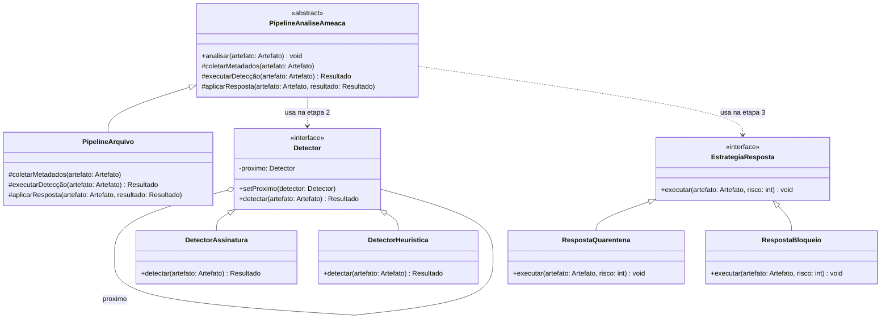

# Padrões Comportamentais Integrados: Chain, Template Method e Strategy
### Pipeline Automatizado de Análise e Resposta a Ameaças (SOAR)

[](https://openjdk.java.net/)
[](https://junit.org/junit5/)

Implementação integrada dos padrões **Chain of Responsibility**, **Template Method** e **Strategy** em Java. O projeto simula um pipeline de um sistema SOAR (Security Orchestration, Automation and Response), demonstrando como orquestrar fluxos rígidos, processar dados através de múltiplos filtros e executar ações dinâmicas de mitigação.

---

## Descrição

### O Problema
Em um Centro de Operações de Segurança (SOC), a análise de um artefato suspeito (ex: um arquivo ou pacote de rede) exige um fluxo de trabalho padronizado, mas com etapas internas altamente variáveis:
1. O fluxo macro (Coletar -> Analisar -> Responder) nunca deve ser alterado arbitrariamente.
2. A fase de "Analisar" pode envolver múltiplos motores de detecção (Assinatura, Heurística, Sandbox) que devem ser executados em sequência.
3. A fase de "Responder" deve variar dinamicamente (Quarentena, Bloqueio de IP, Apenas Alerta) dependendo do nível de severidade, sem alterar o pipeline principal.

Implementar isso com condicionais aninhadas viola o **Princípio Aberto/Fechado (OCP)** e o **Princípio da Responsabilidade Única (SRP)**.

### A Solução Integrada
Cada padrão assume uma responsabilidade arquitetural específica no pipeline:
*   **Template Method:** Define o esqueleto inegociável do pipeline (`analisarAmeaca()`), garantindo que a ordem das etapas seja respeitada.
*   **Chain of Responsibility:** Implementa a etapa de "Detecção". O artefato passa por uma cadeia de motores de análise.
*   **Strategy:** Implementa a etapa de "Resposta". O algoritmo de mitigação é injetado e trocado em tempo de execução.

---

## Estrutura do Projeto

```bash
src/
├── main/
│   └── padroescomportamentais/integracao/
│       ├── PipelineAnaliseAmeaca.java       ⁦(Template Method - Contexto)⁩
│       ├── PipelineArquivo.java             ⁦(ConcreteTemplate)⁩
│       ├── Detector.java                    ⁦(Chain - Handler Interface)⁩
│       ├── DetectorAssinatura.java          ⁦(Chain - ConcreteHandler)⁩
│       ├── DetectorHeuristica.java          ⁦(Chain - ConcreteHandler)⁩
│       ├── EstrategiaResposta.java          ⁦(Strategy - Interface)⁩
│       ├── RespostaQuarentena.java          ⁦(Strategy - ConcreteStrategy)⁩
│       └── RespostaBloqueio.java            ⁦(Strategy - ConcreteStrategy)⁩
│
└── test/
└── padroescomportamentais/integracao/
└── PipelineIntegradoTest.java       ⁦(Casos de teste)⁩
```
---

## Diagrama de Classes Integrado

O diagrama abaixo ilustra como os três padrões coexistem. O **Template** (roxo) orquestra o fluxo, delegando a etapa de detecção para a **Chain** (azul) e a etapa de resposta para a **Strategy** (verde).



---

## Análise Crítica: Vantagens e Pontos Cegos

Integrar padrões aumenta o poder expressivo do código, mas também multiplica a complexidade. Abaixo estão os fatos e os contrapontos críticos desta arquitetura.

### 1. Template Method (A Orquestração)
*   **Fato:** Garante que nenhuma etapa do pipeline seja pulada. O método `analisar()` é `final`.
*   **Ponto Cego (Rigidez):** O Template Method fixa a ordem das etapas em tempo de compilação. Se o negócio exigir que a "Resposta" ocorra *antes* da "Detecção" em cenários específicos, o Template falha.
*   **Contraponto:** Se o fluxo macro for verdadeiramente inegociável (como em protocolos de segurança compliance), a rigidez é uma **vantagem**, não um defeito. Para fluxos dinâmicos, prefira orquestradores baseados em eventos.

### 2. Chain of Responsibility (A Detecção)
*   **Fato:** Permite adicionar novos motores de detecção (ex: `DetectorSandbox`) sem tocar no código do pipeline ou dos outros detectores (OCP).
*   **Ponto Cego (Opacidade e Performance):** Passar um objeto por 10 handlers torna o *debugging* difícil e adiciona overhead de chamadas de método. Além disso, se um handler esquecer de chamar o próximo, a cadeia quebra silenciosamente.
*   **Contraponto:** É obrigatório implementar um sistema de logs/telemetria dentro da cadeia para rastrear por quais handlers o artefato passou.

### 3. Strategy (A Resposta)
*   **Fato:** Permite que o cliente (ou o próprio pipeline) escolha o algoritmo de mitigação em tempo de execução baseado no `Resultado` da Chain.
*   **Ponto Cego (Acoplamento do Cliente):** O padrão Strategy remove o `if/else` do contexto, mas **empurra a complexidade da escolha para quem instancia a Strategy**. 
*   **Contraponto:** Em projetos reais, a escolha da Strategy raramente é feita "na mão". Ela deve ser encapsulada por um **Factory Method** ou resolvida via Injeção de Dependência (DI) baseada no nível de risco.

---

## Diferenças Cruciais na Integração

| Padrão | Papel no Pipeline | Mecanismo de Variação | O que muda em tempo de execução? |
| :--- | :--- | :--- | :--- |
| **Template Method** | **Esqueleto** (Macro) | Herança | Nada. A estrutura é fixa em tempo de compilação. |
| **Chain of Responsibility** | **Processamento** (Micro) | Composição (Lista) | A sequência e a quantidade de handlers na cadeia. |
| **Strategy** | **Ação Final** (Saída) | Composição (Objeto) | O algoritmo específico de mitigação aplicado. |

---

## Testes

O projeto contém testes unitários (JUnit 5) que validam a integração:
*   O Template Method executa as etapas na ordem estrita (Coletar -> Detectar -> Responder).
*   A Chain of Responsibility passa o artefato sequencialmente e acumula o nível de risco.
*   A Strategy é trocada dinamicamente e executa a mitigação correta sem alterar o pipeline.
*   A adição de um novo `Detector` ou nova `EstrategiaResposta` não exige modificação na classe `PipelineArquivo`.

## Tecnologias Utilizadas

| Tecnologia | Versão | Finalidade no Projeto |
| :--- | :--- | :--- |
| **Java** | 21 | Linguagem de programação principal |
| **Maven** | 3.9+ | Gerenciamento de dependências e automação de build |
| **JUnit 5** | 5.9.x | Framework para execução dos testes unitários |
| **Draw.io** | Web | Criação e exportação dos diagramas UML |
